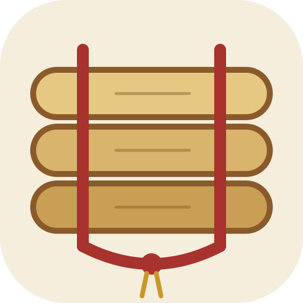

# BailanCraft app icon

A bundle of three palm-leaf (ใบลาน) manuscript leaves, threaded and tied with a red cord that ends
in a knot with a gold tassel, on a palm-leaf cream tile. File names keep the upstream `pdfcraft`
spelling so the build and packaging scripts need no changes.

| Colour | Hex | Used for |
|---|---|---|
| Cream | `#F6EEDC` | tile |
| Leaf | `#E6C882` `#D8B46C` `#C99F55` | the three leaves, light to dark |
| Ink brown | `#8A5A2B` | leaf outlines and grain |
| Lacquer red | `#A8322D` | cord and knot |
| Gold | `#C9972B` | tassel |

The master is `pdfcraft.svg` (512 px tile, corner radius 112). Edit it, then run
`packaging/bailancraft-icons.ps1` and update the sha256 values in `ATTRIBUTION.toml`.
The lines and outlines are thick on purpose: the 16 px taskbar icon must still read as three
leaves and a cord.
